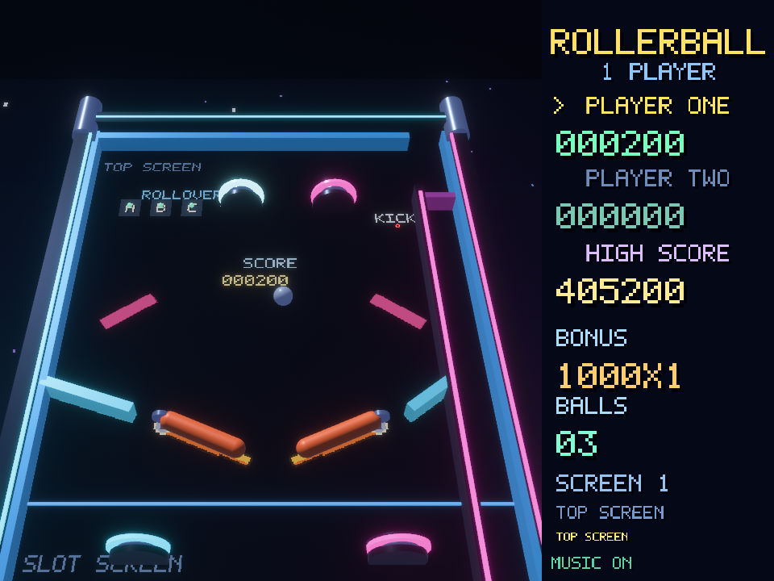

# ROLLERBALL 3D



A playable four-screen pinball game in Rust with Bevy 0.20 and Avian2D 0.8.
It is a clean-room tribute to the 1984 MSX pinball classic, rebuilt in a modern
perspective-3D style: four stacked screens, flippers on every screen, A/B/C
lanes, bumpers, slingshots, drop targets, kickback holes, a three-reel slot
machine, bonus countdown, three balls, 1P/2P and a Match Play score attack.

The rules and the 120 Hz physics stay the same as the earlier 2D build. The
presentation is now a tilted 3D cabinet: a printed playfield is laid on a
slab, and raised rails, chrome posts, glowing bumpers, a three-reel cabinet,
a plunger and a polished steel ball sit above it. The camera follows the ball
smoothly up and down the four screens. The right-hand 30% sidebar is still a
fixed, deliberately retro HUD.

There is also an original looping 8-bit pinball soundtrack on its own audio
channel, with the N key as a mute switch.

The mode menu sits inside the fixed sidebar instead of covering the table, so
the cabinet is visible and playable from the very first frame. Enter, Space, a
flipper key or a mouse click starts a one-player game; 2 and 3 jump straight
into two-player or Match Play. Arrow keys (or W/S) move the highlight, and the
fourth entry, EXIT GAME, closes the game with Enter — useful in fullscreen,
where there is no window close button. Escape on the start menu does the same.
As soon as a game starts the mode labels are replaced by the live scores, floor
name and messages. F12 saves a screenshot.

The playfield background is the supplied space artwork
(`assets/backgrounds/space_background.png`): the planet sits on the bottom
screen and the glowing ball trails sweep up the top screen. A widescreen photo
cannot be stretched onto a 224 x 960 table without distortion, so it is cut into
four aspect-correct columns, one per screen, with a dark wash on top to keep the
inserts and score panels readable.

## Get it

The source is on GitHub:
<https://github.com/simondewaal1980/rollerball-3d>

### Ready to play (Linux, no Rust needed)

The [latest release](https://github.com/simondewaal1980/rollerball-3d/releases/latest)
has a ready-to-run Linux x86_64 build. Unpack the folder, keep `assets` next to
the program, and start `./rollerball`. `LEESMIJ.txt` in the download (and
`docs/RUN-LINUX.txt` in the source) has the same steps in Dutch, with the full
key list.

### Build from source

```sh
git clone https://github.com/simondewaal1980/rollerball-3d
cd rollerball-3d
cargo run --release
```

You need a recent stable Rust toolchain (`rustup` installs it). On Debian or
Ubuntu the window and audio libraries come from:

```sh
sudo apt install build-essential pkg-config libasound2-dev libudev-dev \
  libx11-dev libxi-dev libxcursor-dev libxrandr-dev libwayland-dev \
  libxkbcommon-dev
```

The first build takes a few minutes because Bevy is large. The finished game
runs straight from `target/release/rollerball`. It is built and tested on Linux
(x86_64), where sound goes through ALSA.

## Run

```sh
cargo run --release
```

The game opens in borderless fullscreen on the current monitor. The whole
320 x 240 pinball canvas stays at its 4:3 proportions and is centred with dark
bars, so nothing is stretched on a widescreen display. Press F11 (or Alt+Enter)
at any time to switch back to the 960 x 720 window, and the same keys return to
fullscreen. The bottom of the sidebar always shows the current key. Start with

```sh
cargo run --release -- --windowed
```

to keep the small window from the first frame.

For a quick automated check:

```sh
cargo run -- --screenshot shots/table.png
cargo run -- --self-test selftest.json
```

The screenshot option opens the window without requesting focus and exits after
saving the picture. The self-test looks at the start menu (including the EXIT
GAME entry), presses the same start key a player uses, charges and releases the
plunger, flips, measures the ball, flipper and HUD, checks that the mode menu
leaves the sidebar, drops the ball in above the slot machine to confirm it rolls
clear, rests a ball on the rounded edge of a flipper to confirm it rolls off
instead of hanging, writes its JSON result and exits.

## Controls

| Action | Keys |
|---|---|
| Left flipper | Left Shift, Z, Left Arrow |
| Right flipper | Right Shift, M, Right Arrow |
| Plunger | Hold Space, release to shoot |
| Nudge / tilt warning | W or Up Arrow |
| Start / confirm | Enter, Space, Z/M, Left/Right Shift, Left/Right Arrow or mouse click |
| Quick start | 1 one player, 2 two players, 3 Match Play |
| Pause | P |
| Fullscreen / window | F11 or Alt+Enter |
| Music on/off | N |
| Screenshot | F12 (saves `shots/screenshot.png`) |
| Back to menu | Escape |
| Exit game | EXIT GAME on the start menu, then Enter; Escape at the start menu also quits |

Only the flippers on the screen the ball is on are live.

## Sound

The game looks for `assets/audio/sounds.ron`, which maps each sound event to a
`.wav` or `.ogg` file and a volume in dB. Drop your own files into
`assets/audio/` and point the RON file at them; no recompile is needed. An event
may list several files, and the game picks one at random per hit — the three
bumper takes and two flipper takes keep repeated hits from sounding identical.

All fifteen events ship with a clip (eighteen WAV and `slot_win.ogg`). They are
original recreations in the voice of the MSX AY-3-8910 PSG, not samples from the
1984 game: three square-wave channels, noise, 16-step volume envelopes, pitch
sweeps and short arpeggios. Files are decoded before playback; a missing, empty
or corrupt file is replaced by a procedural PSG patch generated in code, so the
game always has sound. Start-up logs how many files loaded and exactly which
events used the fallback. If you own a recording of the original table, give the
files these names (or edit `sounds.ron`) and the game will use them on the next
start.

The background tune is `assets/audio/music_theme.wav`, mapped by the `music`
entry in `sounds.ron`. It is an original 8-bar, 126 BPM A-minor chiptune
(Am-F-C-G) with two square voices, a triangle bass and a noise drum kit, not a
recording from 1984. It loops on a dedicated Kira channel at -16 dB and can be
replaced with any 15-second-or-longer `.wav` or `.ogg` file. If the file is
missing or unreadable, `synth_music()` generates a procedural 8-bit loop in
code instead. N mutes the music without affecting the effects.

`tools/generate_audio.py` rebuilds the shipped effects bank, and
`tools/generate_music.py` rebuilds the soundtrack.

## 3D presentation notes

The playfield art is rendered into a 448 x 1920 nearest-neighbour texture and
mapped onto the 3D slab, so every original lane label, lamp and score display
remains readable while the perspective camera supplies depth. The hardware
above it is built from real meshes: cylinders and torus crowns for the
bumpers, capsules for the flippers, a three-reel cabinet frame, kickback rings
that change from red to green when armed, a chrome plunger, drop-target bars,
and a UV sphere with a metallic material for the ball. The supplied space
artwork supplies the playfield backdrop, while a dim starfield and cyan/magenta
point lights keep the cabinet from floating in a void. The art pass uses an
extended far plane (2000 instead of 1000) so decals behind z=0 — background,
screen seams and panels — are not clipped out of the printed texture.
The cabinet is always composed inside a centred 4:3 area. In fullscreen a
widescreen monitor gets dark side bars instead of a stretched table, and the
sidebar keeps its exact 30% width. All the camera and presentation numbers are
in `MECHANICS.md` and `mechanics.json`.

## Physics notes

The simulation uses a fixed 120 Hz step. The ball has swept CCD against every
body type plus speculative CCD, so a 2000+ px/s plunger shot cannot tunnel
through a flipper. Flippers are kinematic capsules with a 48° limited sweep.
Their stroke is driven by the fixed physics clock (so it does not change with
the frame rate), they brake exactly at both end stops, and a hit is scaled by
where the ball touches the rubber: weak near the hinge, strongest at the tip.
A ball resting on a held-up flipper is not fired into the air. The ball now
rolls freely instead of having its rotation locked, so it works its way down a
passive rubber face instead of hanging on it; a slow ball still sitting on the
rubber, the rounded tip or the hinge gets a gentle downhill shove after 0.75 s.
The funnel walls stop short of the hinges to leave a real outlane instead of a
pocket that traps the ball. The slot cabinet has a peaked cap instead of a
flat shelf, so a landing ball rolls off; if one still hesitates there, a 1.1 s
slot-area rescue gives it a sideways nudge. Bumpers and slingshots add
restitution plus a scored impulse. All the tunable numbers are listed in
`MECHANICS.md` and `mechanics.json`.
